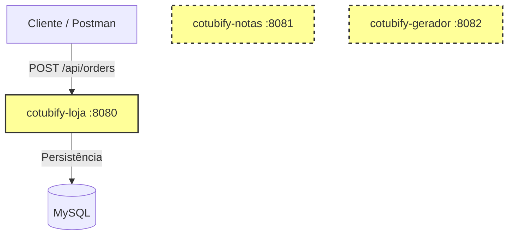
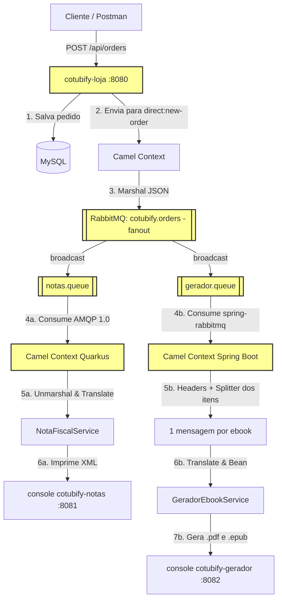

# 🖥️ Live UniPDS - Introdução ao Apache Camel

Este projeto foi desenvolvido para a Live de Introdução ao **Apache Camel** na pós-graduação **Java + IA** da **UniPDS**. 

O objetivo prático é integrar três microserviços independentes de uma loja online de Ebooks chamada **Cotubify**, evoluindo de uma arquitetura com sistemas isolados para uma arquitetura orientada a eventos usando **RabbitMQ** e o framework de integração **Apache Camel** (com abordagens tanto em **Spring Boot** quanto em **Quarkus**).

---

## 🏗️ Arquitetura

O sistema é composto por 3 aplicações distintas que representam o ecossistema da loja **Cotubify**:

1. **`cotubify-loja`** (Porta `8080`): API em Spring Boot para consulta de catálogo e recepção de pedidos. Persiste as informações em um banco MySQL.
2. **`cotubify-notas`** (Porta `8081`): Serviço em Quarkus responsável por receber os dados de um pedido e simular a geração de uma Nota Fiscal eletrônica em formato XML.
3. **`cotubify-gerador`** (Porta `8082`): API em Spring Boot que simula o pipeline de compilação do Ebook (geração dos arquivos `.pdf` e `.epub` a partir de uma fonte Markdown em repositório Git).

### Ponto de partida (branch `main`)

Os sistemas estão isolados. O pedido é feito na loja e persistido no banco de dados, mas as notas fiscais não são geradas automaticamente e os ebooks não são compilados.



## 🛠️ Tecnologias e Versões Utilizadas

| Componente | Framework / Core | Versão | Java | Principais Bibliotecas & Starters Camel |
| :--- | :--- | :--- | :--- | :--- |
| **`cotubify-loja`** | Spring Boot | `4.1.0` | `25` | `camel-spring-boot-starter`<br>`camel-spring-rabbitmq-starter`<br>`camel-jackson-starter`<br>`spring-boot-starter-amqp` |
| **`cotubify-notas`** | Quarkus | `3.36.3` | `25` | `camel-quarkus-amqp`<br>`camel-quarkus-jackson` |
| **`cotubify-gerador`**| Spring Boot | `4.1.0` | `25` | `camel-spring-boot-starter`<br>`camel-spring-rabbitmq-starter`<br>`camel-jackson-starter`<br>`spring-boot-starter-amqp` |
| **MySQL (Docker)** | MySQL | `9.0` | N/A | Banco de dados relacional da loja |
| **RabbitMQ (Docker)**| RabbitMQ | `4.2` | N/A | Broker de mensageria |

> [!NOTE]
> Os projetos Spring Boot (`cotubify-loja` e `cotubify-gerador`) importam o BOM `camel-spring-boot-bom` na versão `4.21.0`. O `cotubify-notas` usa o `quarkus-camel-bom`, alinhado à versão da plataforma Quarkus.

---

## 📂 Estrutura e Classes de Domínio

### 🛒 `cotubify-loja` (Spring Boot)
Gerencia o banco de dados via JPA/Hibernate e inicializa os dados usando Flyway.
- **Entidades de Banco (`br.com.unipds.cotubify.loja.entity`):**
  - [Ebook.java](file:///Users/alexandreaquiles/Documents/unipds/projetos-lives/live-apache-camel/cotubify-loja/src/main/java/br/com/unipds/cotubify/loja/entity/Ebook.java): Contém título, preço, ISBN, e a URL do repositório Git de origem.
  - [Author.java](file:///Users/alexandreaquiles/Documents/unipds/projetos-lives/live-apache-camel/cotubify-loja/src/main/java/br/com/unipds/cotubify/loja/entity/Author.java): Dados do autor (Nome, mini-bio).
  - [Order.java](file:///Users/alexandreaquiles/Documents/unipds/projetos-lives/live-apache-camel/cotubify-loja/src/main/java/br/com/unipds/cotubify/loja/entity/Order.java): Pedido mapeado contendo cliente, CPF, e endereço.
  - [OrderItem.java](file:///Users/alexandreaquiles/Documents/unipds/projetos-lives/live-apache-camel/cotubify-loja/src/main/java/br/com/unipds/cotubify/loja/entity/OrderItem.java): Itens comprados, preço histórico de venda e desconto aplicado.
- **DTOs (`br.com.unipds.cotubify.loja.dto`):**
  - `OrderRequestDTO` e `OrderItemRequestDTO`.
- **Integração (`br.com.unipds.cotubify.loja.integration`):**
  - [OrderRoute.java](file:///Users/alexandreaquiles/Documents/unipds/projetos-lives/live-apache-camel/cotubify-loja/src/main/java/br/com/unipds/cotubify/loja/integration/OrderRoute.java): serializa o pedido em JSON e publica na exchange **fanout** `cotubify.orders`.

### 🧾 `cotubify-notas` (Quarkus)
Serviço simples que opera como gerador de Nota Fiscal.
- **DTOs de Entrada (`br.com.unipds.cotubify.notas.dto`):**
  - [PedidoDTO.java](file:///Users/alexandreaquiles/Documents/unipds/projetos-lives/live-apache-camel/cotubify-notas/src/main/java/br/com/unipds/cotubify/notas/dto/PedidoDTO.java): Modelo simplificado contendo ID do pedido, dados do cliente e lista de itens.
  - [ItemPedidoDTO.java](file:///Users/alexandreaquiles/Documents/unipds/projetos-lives/live-apache-camel/cotubify-notas/src/main/java/br/com/unipds/cotubify/notas/dto/ItemPedidoDTO.java): Itens com o preço de compra e desconto.
- **Serviço:**
  - [NotaFiscalService.java](file:///Users/alexandreaquiles/Documents/unipds/projetos-lives/live-apache-camel/cotubify-notas/src/main/java/br/com/unipds/cotubify/notas/service/NotaFiscalService.java): Calcula o valor total líquido (Preço - Desconto), monta um payload XML e faz a saída no console.
- **Integração (`br.com.unipds.cotubify.notas.integration`):**
  - [NotaFiscalRoute.java](file:///Users/alexandreaquiles/Documents/unipds/projetos-lives/live-apache-camel/cotubify-notas/src/main/java/br/com/unipds/cotubify/notas/integration/NotaFiscalRoute.java): consome a `notas.queue` via AMQP 1.0 e traduz o JSON da loja para o `PedidoDTO` (incluindo a lista de itens).

### ⚙️ `cotubify-gerador` (Spring Boot)
API REST que simula a pipeline de criação de arquivos físicos `.pdf` e `.epub`.
- **DTOs de Entrada (`br.com.unipds.cotubify.gerador.dto`):**
  - [GeracaoEbookRequest.java](file:///Users/alexandreaquiles/Documents/unipds/projetos-lives/live-apache-camel/cotubify-gerador/src/main/java/br/com/unipds/cotubify/gerador/dto/GeracaoEbookRequest.java): ID do pedido, cliente, título do ebook e a URL Git a ser clonada.
- **Serviço:**
  - [GeradorEbookService.java](file:///Users/alexandreaquiles/Documents/unipds/projetos-lives/live-apache-camel/cotubify-gerador/src/main/java/br/com/unipds/cotubify/gerador/service/GeradorEbookService.java): Imprime no console o progresso de geração do ebook (com um `Thread.sleep` de 2s simulando a compilação do PDF/EPUB).
- **Integração (`br.com.unipds.cotubify.gerador.integration`):**
  - [GeradorEbookRoute.java](file:///Users/alexandreaquiles/Documents/unipds/projetos-lives/live-apache-camel/cotubify-gerador/src/main/java/br/com/unipds/cotubify/gerador/integration/GeradorEbookRoute.java): consome a `gerador.queue`, guarda os dados do pedido em headers e faz o **Splitter** dos itens, gerando um ebook por item (em paralelo).

---

## ⚡ Como Executar o Projeto

### Passo 1: Subir a Infraestrutura (Docker)
Na pasta raiz e inicie os containers do MySQL e RabbitMQ:
```bash
docker compose up -d
```
O RabbitMQ já sobe com a exchange, as filas e os bindings criados — veja [Topologia do RabbitMQ](#-topologia-do-rabbitmq-importada-automaticamente) logo abaixo.

> [!NOTE]
> * **RabbitMQ UI:** acesse em `http://localhost:15672` (Usuário: `admin` / Senha: `senha123`).
> * **MySQL:** exposto na porta `3306` (Usuário: `admin` / Senha: `senha123`, Banco de dados: `cotubify`).

#### 📨 Topologia do RabbitMQ (importada automaticamente)

Nenhuma das rotas declara a topologia (o consumidor do gerador usa `autoDeclare=false`), então a exchange, as filas e os bindings precisam existir **antes** de subir as aplicações. Essa configuração está versionada no [definitions-rabbit.json](file:///Users/alexandreaquiles/Documents/unipds/projetos-lives/live-apache-camel/definitions-rabbit.json) e é carregada pelo broker **a cada boot** — não há passo manual:

| Recurso | Nome | Tipo | Observação |
| :--- | :--- | :--- | :--- |
| Exchange | `cotubify.orders` | `fanout` | Publish-Subscribe Channel — faz broadcast do pedido |
| Fila | `notas.queue` | `classic` | Consumida pelo `cotubify-notas` (AMQP 1.0) |
| Fila | `gerador.queue` | `classic` | Consumida pelo `cotubify-gerador` (spring-rabbitmq) |
| Binding | `cotubify.orders` → `notas.queue` | — | Sem routing key (fanout ignora) |
| Binding | `cotubify.orders` → `gerador.queue` | — | Sem routing key (fanout ignora) |

O `docker-compose.yml` monta dois arquivos no container e um volume nomeado para os dados do broker:

```yaml
volumes:
  # conf.d preserva o rabbitmq.conf gerado pela imagem a partir das variáveis de ambiente
  - ./rabbitmq.conf:/etc/rabbitmq/conf.d/20-load-definitions.conf:ro
  - ./definitions-rabbit.json:/etc/rabbitmq/definitions.json:ro
  - rabbitmq_data:/var/lib/rabbitmq
```

O [rabbitmq.conf](file:///Users/alexandreaquiles/Documents/unipds/projetos-lives/live-apache-camel/rabbitmq.conf) tem uma linha só — `load_definitions = /etc/rabbitmq/definitions.json` — e é montado dentro de `conf.d/` justamente para não sobrescrever o `rabbitmq.conf` que a imagem gera a partir do `RABBITMQ_DEFAULT_USER`/`RABBITMQ_DEFAULT_PASS`.

Para conferir, acesse a **RabbitMQ UI** em `http://localhost:15672` (`admin` / `senha123`): na aba **Exchanges** a `cotubify.orders` deve aparecer como `fanout` e, ao clicar nela, as duas filas devem estar listadas em *Bindings*. Pela linha de comando:

```bash
curl -s -u admin:senha123 http://localhost:15672/api/exchanges/%2F/cotubify.orders/bindings/source
```

Se você **editar** o `definitions-rabbit.json`, basta reiniciar o broker (`docker compose restart rabbit`) para reimportar. Também dá para importar manualmente pela UI em **Overview → Import definitions** ou via API:

```bash
curl -u admin:senha123 -X POST http://localhost:15672/api/definitions \
  -H "Content-Type: application/json" \
  --data-binary @definitions-rabbit.json
```

> [!IMPORTANT]
> Quando há definições para carregar, o RabbitMQ **não** cria o usuário padrão (`Will not seed default virtual host and user: have definitions to load...`). O usuário `admin` passa a vir do próprio `definitions-rabbit.json`, que contém o hash da senha `senha123`. Ou seja: alterar `RABBITMQ_DEFAULT_USER`/`RABBITMQ_DEFAULT_PASS` no compose não muda mais as credenciais — é preciso regerar o arquivo de definições.

> [!NOTE]
> O arquivo foi exportado de um broker de desenvolvimento e inclui o usuário `admin` e suas permissões. Por isso ele só serve para o ambiente local desta live; não reaproveite em outros ambientes.

### Passo 2: Rodar os Microserviços
Execute cada um dos projetos em terminais separados usando os comandos de desenvolvimento:

* **Cotubify Loja (Spring Boot):**
  ```bash
  cd cotubify-loja
  ./mvnw spring-boot:run
  ```
  *(Porta padrão: `8080`)*

* **Cotubify Notas (Quarkus):**
  ```bash
  cd cotubify-notas
  ./mvnw quarkus:dev
  ```
  *(Porta padrão: `8081`)*

* **Cotubify Gerador (Spring Boot):**
  ```bash
  cd cotubify-gerador
  ./mvnw spring-boot:run
  ```
  *(Porta padrão: `8082`)*

---

## 🔌 Exemplos de Requisições das APIs (REST)

Cada microserviço contém sua respectiva collection do Postman na raiz do seu diretório. Abaixo estão os exemplos formatados para testes rápidos via `curl`:

### 🛒 1. Cotubify Loja (Porta 8080)
#### Listar Ebooks Cadastrados (GET)
```bash
curl -X GET http://localhost:8080/api/ebooks
```
**Resposta esperada (JSON):**
```json
[
  {
    "id": 1,
    "title": "Enterprise Integration Patterns",
    "description": "O livro definitivo sobre padrões de integração de sistemas corporativos.",
    "price": 249.90,
    "gitRepoUrl": "git@github.com:cotubify-internal/eip-book.git",
    "authors": ["Gregor Hohpe", "Bobby Woolf"]
  },
  {
    "id": 2,
    "title": "Refactoring",
    "description": "Melhorando o design de códigos existentes de forma segura e pragmática.",
    "price": 199.90,
    "gitRepoUrl": "git@github.com:cotubify-internal/refactoring-book.git",
    "authors": ["Martin Fowler"]
  }
]
```

#### Criar Novo Pedido (POST)
```bash
curl -X POST http://localhost:8080/api/orders \
-H "Content-Type: application/json" \
-d '{
    "clientName": "Giovana Daiane Simone Ribeiro",
    "cpf": "408.339.952-00",
    "email": "giovana.daiane.ribeiro@fictor.com.br",
    "address": "Avenida Tailândia, 681, Cabralzinho, Macapá / AP",
    "items": [
        { "ebookId": 1, "discount": 50.0 },
        { "ebookId": 2, "discount": 0.0 }
    ]
}'
```

> [!TIP]
> Este é o **único** endpoint que precisa ser chamado para exercitar toda a integração. Com os três serviços no ar, o pedido é publicado na exchange fanout e você verá, em paralelo: a nota fiscal em XML no console do `cotubify-notas` e **dois** ebooks sendo gerados (um por item) no console do `cotubify-gerador`. Os endpoints abaixo servem para testar cada serviço isoladamente, sem passar pelo broker.

---

### 🧾 2. Cotubify Notas (Porta 8081)
#### Simular Nota Fiscal Manualmente (POST)
```bash
curl -X POST http://localhost:8081/api/notas \
-H "Content-Type: application/json" \
-d '{
  "id": 101,
  "nomeCliente": "João Silva",
  "cpfCliente": "111.222.333-44",
  "enderecoCliente": "Rua das Flores, 123",
  "dataCriacao": "2026-06-23T14:30:00",
  "itens": [
    {
      "ebookId": 1,
      "tituloEbook": "Enterprise Integration Patterns",
      "precoCompra": 250.00,
      "desconto": 50.00
    }
  ]
}'
```
**Resposta esperada (XML):**
```xml
<notaFiscal>
  <pedidoId>101</pedidoId>
  <cliente>
    <nome>João Silva</nome>
    <cpf>111.222.333-44</cpf>
    <endereco>Rua das Flores, 123</endereco>
  </cliente>
  <valorTotal>200.00</valorTotal>
  <descricao>
    - Enterprise Integration Patterns (1)
  </descricao>
</notaFiscal>
```

---

### ⚙️ 3. Cotubify Gerador (Porta 8082)
#### Acionar Geração de Ebook Manualmente (POST)
```bash
curl -X POST http://localhost:8082/api/gerador \
-H "Content-Type: application/json" \
-d '{
  "pedidoId": 101,
  "nomeCliente": "João Silva",
  "cpfCliente": "111.222.333-44",
  "ebookId": 1,
  "tituloEbook": "Enterprise Integration Patterns",
  "urlRepositorioGit": "git@github.com:cotubify-internal/eip-book.git"
}'
```

---

## 🎯 Estado Atual da Integração

Os três microserviços estão integrados de forma assíncrona. A loja publica o pedido criado em uma exchange **fanout** (`cotubify.orders`) do RabbitMQ — um **Publish-Subscribe Channel**. A mesma mensagem é entregue para as duas filas:

* **`notas.queue`** → o `cotubify-notas` traduz o JSON para o seu próprio modelo e imprime a nota fiscal em XML.
* **`gerador.queue`** → o `cotubify-gerador` faz o **Splitter** dos itens do pedido e dispara a geração de um ebook por item, em paralelo.

O ponto importante é que a loja **não sabe** quem consome o evento: adicionar um novo consumidor é só criar uma nova fila com binding na exchange, sem tocar no código do produtor.



---

## 🔀 Detalhes da Integração Camel

O fluxo integrado funciona da seguinte forma:

### 1. Produtor: `cotubify-loja`
* **Controller:** No [OrderController.java](file:///Users/alexandreaquiles/Documents/unipds/projetos-lives/live-apache-camel/cotubify-loja/src/main/java/br/com/unipds/cotubify/loja/controller/OrderController.java), a dependência `ProducerTemplate camelTemplate` do Apache Camel é injetada. Após salvar o pedido no banco, o payload da entidade `Order` persistida é enviado para o canal interno do Camel:
  ```java
  Order savedOrder = orderRepository.save(order);
  camelTemplate.sendBody("direct:new-order", savedOrder);
  ```
* **Rota Camel:** No [OrderRoute.java](file:///Users/alexandreaquiles/Documents/unipds/projetos-lives/live-apache-camel/cotubify-loja/src/main/java/br/com/unipds/cotubify/loja/integration/OrderRoute.java), a rota intercepta o pedido, serializa a entidade JPA em JSON usando **Jackson** e publica na exchange **fanout**. Note que não há `routingKey` nem `queues`: o produtor não conhece os consumidores.
  ```java
  from("direct:new-order")
      .log("Camel recebeu um Order de id: ${body.id}")
      .marshal().json(JsonLibrary.Jackson)
      .to("spring-rabbitmq:cotubify.orders?exchangeType=fanout")
      .log("Mensagem produzida com sucesso para o RabbitMQ.");
  ```

### 2. Consumidor: `cotubify-notas` (Message Translator)
* **Configuração:** O arquivo de propriedades injeta a conexão AMQP no Broker de Mensagens.
* **Rota Camel:** No [NotaFiscalRoute.java](file:///Users/alexandreaquiles/Documents/unipds/projetos-lives/live-apache-camel/cotubify-notas/src/main/java/br/com/unipds/cotubify/notas/integration/NotaFiscalRoute.java), o Camel Quarkus consome as mensagens da fila usando AMQP 1.0, realiza a desserialização do JSON para `JsonNode` e executa uma **tradução estrutural de dados** (Pattern *Message Translator*) antes de repassar os dados limpos ao `NotaFiscalService`. A tradução percorre os `items` do pedido, achatando o `ebook` aninhado no `ItemPedidoDTO` do Quarkus:
  ```java
  from("amqp:queue:notas.queue")
      .log("Nova mensagem de pedido recebido do RabbitMQ")
      .unmarshal(new JacksonDataFormat(JsonNode.class))
      .process(exchange -> {
          // items[].ebook.{id,title} + items[].{purchasePrice,discount} -> ItemPedidoDTO
          // e o restante do JSON -> PedidoDTO
      })
      .bean(notaFiscalService, "gerarNotaFiscal");
  ```

### 3. Consumidor: `cotubify-gerador` (Splitter)
* **Configuração:** As credenciais do broker ficam em `spring.rabbitmq.*` no `application.properties`.
* **Rota Camel:** No [GeradorEbookRoute.java](file:///Users/alexandreaquiles/Documents/unipds/projetos-lives/live-apache-camel/cotubify-gerador/src/main/java/br/com/unipds/cotubify/gerador/integration/GeradorEbookRoute.java), o gerador consome a `gerador.queue` (com `autoDeclare=false`, já que a topologia é criada fora da aplicação). Como um pedido pode ter vários ebooks e o gerador trabalha **um ebook por vez**, a rota usa o **Splitter** para quebrar a lista de `items` em uma mensagem por item, com `parallelProcessing()`:
  ```java
  from("spring-rabbitmq:cotubify.orders?queues=gerador.queue&autoDeclare=false")
      .unmarshal().json(JsonLibrary.Jackson)

      // dados do pedido viram headers, pois o body será substituído pelo item
      .setHeader("pedidoId", simple("${body[id]}"))
      .setHeader("nomeCliente", simple("${body[clientName]}"))
      .setHeader("cpfCliente", simple("${body[cpf]}"))
      .setHeader("emailCliente", simple("${body[email]}"))

      .split(simple("${body[items]}")).parallelProcessing()
          .process(exchange -> {
              // item + headers do pedido -> GeracaoEbookRequest
          })
          .bean(geradorEbookService, "gerarPdfEEpub")
      .end()
      .log("Pedido ${header.pedidoId} processado com sucesso. Todos os ebooks gerados.");
  ```
* **Por que headers?** O Splitter troca o body pelo item corrente, então os dados do pedido (id, cliente, CPF) são promovidos a headers antes do split para sobreviverem a cada sub-mensagem — servindo como **Correlation Identifier** entre o pedido e os ebooks gerados. Depois do `.end()`, o Camel volta a ter o contexto do pedido inteiro (**Aggregator** implícito do Splitter), permitindo logar a conclusão de todos os itens.

---

## 📽️ Conteúdo Abordado

### Live 1 — Introdução ao Apache Camel

A primeira live cobriu desde a fundação conceitual até a aplicação prática em arquitetura de microsserviços.

1. **Introdução Teórica aos Padrões de Integração Corporativa (EIPs)**
   * O que é o Apache Camel e por que ele é considerado o "canivete suíço" da integração de sistemas?
   * Os conceitos fundamentais: `CamelContext`, `Routes` (Rotas), `Endpoints`, `DSL` (Java/XML/YAML) e `Components`.
2. **Explorando a Loja Cotubify**
   * Análise do estado inicial (Branch `main`).
   * Inicialização da infraestrutura do Docker (MySQL + RabbitMQ).
3. **Mão na Massa: O Lado Produtor (Spring Boot + Camel)**
   * Adicionando as dependências do Camel Spring Boot.
   * Utilizando o `ProducerTemplate` no controller da loja.
   * Criando uma rota (`RouteBuilder`) para formatar e publicar em filas RabbitMQ.
4. **Mão na Massa: O Lado Consumidor (Quarkus + Camel)**
   * Entendendo o ecossistema Quarkus Extension para Camel.
   * Criando a rota de consumo de fila via AMQP 1.0.
   * **Message Transformation:** Mapeando as discrepâncias de formato entre a Loja (Spring) e o Notas (Quarkus) usando Camel DSL e `Processor`.
5. **Simulação Completa do Fluxo**
   * Enviar requisição para a loja, verificar o log de publicação, checar o console do RabbitMQ e visualizar a nota fiscal gerada em tempo real no console do Quarkus.

### Live 2 (29/07/2026) — Publish-Subscribe e Splitter

Integração do terceiro microsserviço (**`cotubify-gerador`**), com o cenário: o compilador de Ebooks também precisa receber os dados do pedido assim que uma venda for concluída, para iniciar a compilação do PDF/EPUB.

1. **O problema do ponto-a-ponto**
   * A rota da Loja apontava direto para a `notas.queue` (`routingKey=notas`). Adicionar um segundo consumidor exigiria mudar o produtor.
2. **Publish-Subscribe Channel**
   * Troca da exchange para o tipo **fanout** (`spring-rabbitmq:cotubify.orders?exchangeType=fanout`): a loja publica um evento e o broker faz o broadcast.
   * Criação da `gerador.queue` com binding na mesma exchange — nenhuma linha alterada no consumidor de notas. A topologia final está exportada em [definitions-rabbit.json](file:///Users/alexandreaquiles/Documents/unipds/projetos-lives/live-apache-camel/definitions-rabbit.json).
3. **Camel no `cotubify-gerador` (Spring Boot)**
   * Adição do `camel-spring-boot-starter`, `camel-spring-rabbitmq-starter` e `camel-jackson-starter` (BOM `4.21.0`).
   * Rota consumindo com `autoDeclare=false`, já que a topologia é criada previamente no broker.
4. **Splitter EIP**
   * Um pedido tem N ebooks, mas o gerador processa um por vez: `.split(simple("${body[items]}")).parallelProcessing()`.
   * Uso de **headers** para preservar os dados do pedido (Correlation Identifier) durante o split, e log de conclusão após o `.end()`.
5. **Fechando o Message Translator do `cotubify-notas`**
   * Mapeamento da lista de `items` (com o `ebook` aninhado) para os `ItemPedidoDTO`, completando o cálculo do valor total da nota.

### 🏆 Próximos Passos
* **Claim Check:** evitar trafegar o pedido inteiro na mensagem, guardando o payload em um armazenamento externo (ex: S3) e enviando apenas a referência.
* **Tratamento de erros:** `onException`, `errorHandler`, política de retry e **Dead Letter Channel** para mensagens que falham no processamento.
